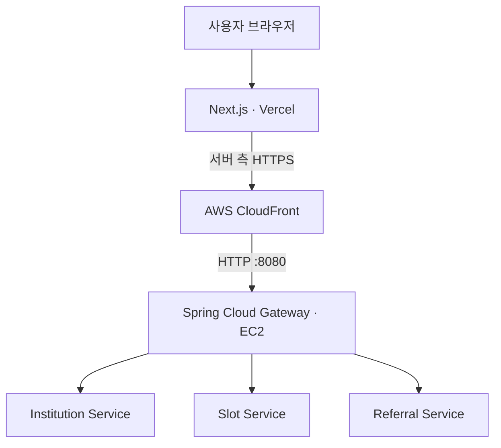

# IT:DA — 영상검사 의뢰·예약 관리 플랫폼

> 의료기관 간 CT·MRI 검사 의뢰부터 예약, 검사 진행, 결과 확인까지 연결하는 B2B 의료 협력 플랫폼

## 목차

1. [프로젝트 소개](#1-프로젝트-소개)
2. [주요 기능과 화면](#2-주요-기능과-화면)
3. [기술 스택](#3-기술-스택)
4. [프론트엔드 아키텍처](#4-프론트엔드-아키텍처)
5. [프로젝트 구조](#5-프로젝트-구조)
6. [로컬 실행 방법](#6-로컬-실행-방법)
7. [테스트](#7-테스트)
8. [배포](#8-배포)
9. [트러블슈팅 및 기술적 개선](#9-트러블슈팅-및-기술적-개선)
10. [향후 개선 사항](#10-향후-개선-사항)

---

## 1. 프로젝트 소개

의뢰기관과 검사기관 사이에는 검사 일정 확인, 예약 조정, 검사 진행, 결과 전달 등 여러 업무 단계가 존재합니다. 특히 검사 장비가 갑자기 중단되면 기존 예약을 확인하고 대체 일정을 조율해야 합니다.

IT:DA는 다음 세 가지 문제에 집중했습니다.

- **업무 흐름 연결:** 기관별로 분리되기 쉬운 검사 의뢰·예약·검사 결과 정보를 하나의 화면 흐름으로 제공
- **예약 관리 효율화:** 협력기관의 검사 가능 슬롯을 검색하고 예약 및 상태 변경을 확인
- **장애 상황 대응:** 장비 중단에 영향을 받는 예약을 확인하고 새로운 검사 슬롯으로 재조정 지원

### 사용자 유형

| 역할 | 사용자 | 주요 업무 |
| --- | --- | --- |
| `REQUESTER` | 의뢰기관 담당자 | 슬롯 검색, 검사 의뢰·예약, 재조정, 결과 확인 |
| `EXAMINER` | 검사기관 담당자 | 장비·슬롯 관리, 예약 및 검사 진행, 결과 등록, 장비 장애 관리 |
| `ADMIN` | 플랫폼 관리자 | 사용자 승인, 기관 등록 및 운영 정보 관리 |

## 2. 주요 기능과 화면

역할에 따라 업무 화면과 메뉴를 분리하고, 테이블·카드·입력 모달을 업무 흐름에 맞게 구성했습니다.

### 2.1 의뢰기관 (`REQUESTER`)

| 기능 | 화면에서 할 수 있는 일 |
| --- | --- |
| 대시보드 | 검사 의뢰 및 예약 현황 확인 |
| 슬롯 검색 | 협력기관, 검사 유형, 날짜·시간대, 지원 장비 조건으로 검색 |
| 검사 의뢰·예약 | 의뢰 생성, 예약 목록·상세 조회 및 취소 |
| 예약 재조정 | 재조정 대상 확인, 대체 슬롯 검색, 변경 전후 비교 및 요청 |
| 알림·결과 | 상태 변경 알림 확인·읽음 처리, 검사 결과 조회 |

### 2.2 검사기관 (`EXAMINER`)

| 기능 | 화면에서 할 수 있는 일 |
| --- | --- |
| 대시보드 | 예약 및 검사 진행 현황 확인 |
| 장비 관리 | 장비 등록·조회 및 운영 상태 확인 |
| 슬롯 관리 | 검사 가능 시간 등록, 슬롯 조회 및 상태 확인 |
| 예약·검사 관리 | 예약 상세 확인, 검사 상태 변경 및 결과 등록 |
| 장비 장애 관리 | 장비 중단 일정·사유 등록, 장애 목록 및 영향 의뢰 확인 |
| 알림 | 검사·예약 관련 알림 확인 |

### 2.3 관리자 (`ADMIN`)

- 사용자 승인 및 관리
- 기관 등록 및 관리
- 플랫폼 운영 현황 및 관리 대상 조회

> 관리자 작업은 화면별로 구현된 범위와 백엔드 권한 정책을 따릅니다. 운영자가 직접 처리해야 하는 예외 작업은 최종 구현 범위를 확인한 뒤 문서에 추가합니다.

### 2.4 핵심 사용자 흐름 — 장비 장애와 예약 재조정

장비 장애로 확정 예약을 유지할 수 없을 때, 의뢰기관 담당자가 대체 슬롯을 선택해 예약을 복구하는 흐름을 지원합니다.

1. 검사기관이 장비 사용 중단 정보를 등록합니다.
2. 백엔드에서 영향받는 예약을 처리하고 재조정이 필요한 의뢰를 식별합니다.
3. 의뢰기관 담당자는 알림 및 재조정 대상 목록을 확인합니다.
4. 기존 예약 정보를 보면서 대체 슬롯을 검색합니다.
5. 변경 전·후 정보를 비교한 뒤 재조정을 요청합니다.
6. 프론트엔드는 서버 상태를 다시 조회해 처리 진행 상황을 표시합니다.

### 2.5 주요 화면

IT:DA의 역할별 주요 기능과 핵심 업무 흐름을 보여주는 대표 화면입니다.

> **화면 이미지 추가 예정:** 최종 배포 및 기능 검증 후 아래 순서대로 캡처를 추가합니다. 실제 의료·환자 정보는 노출하지 않고 시연용 데이터만 사용합니다.

| 우선순위 | 화면 | 화면에서 강조할 내용 | 이미지 예정 경로 |
| --- | --- | --- | --- |
| **필수** | 의뢰기관 — 슬롯 검색 | 협력기관·검사 유형·날짜·지원 장비별 검색과 검색 결과 | `docs/images/requester-slot-search.png` |
| **필수** | 의뢰기관 — 검사 의뢰·예약 | 슬롯 선택부터 의뢰 생성 및 예약 상태 확인까지의 흐름 | `docs/images/requester-referral-reservation.png` |
| **필수** | 검사기관 — 장비 장애 관리 | 장비 중단 등록 모달과 장애 영향 예약 확인 | `docs/images/examiner-equipment-incident.png` |
| **필수** | 의뢰기관 — 예약 재조정 | 기존 예약과 대체 슬롯 비교, 재조정 요청 및 처리 상태 | `docs/images/requester-reschedule.png` |
| 권장 | 검사기관 — 검사 관리 | 예약·검사 목록, 검사 상태 변경 및 결과 등록 | `docs/images/examiner-examination.png` |
| 권장 | 관리자 — 사용자·기관 관리 | 사용자 승인과 기관 관리 기능 | `docs/images/admin-management.png` |
| 선택 | 역할별 대시보드 | 의뢰기관·검사기관의 업무 현황 비교 | `docs/images/role-dashboards.png` |

**캡처 구성 권장사항**

- README에서는 핵심 업무 흐름인 **슬롯 검색 → 의뢰 생성 → 장비 장애 → 예약 재조정**의 4개 화면을 가장 먼저 배치합니다.
- 재조정 화면은 가능하면 *기존 예약 요약 → 대체 슬롯 검색 → 변경 전후 비교 → 처리 결과*가 드러나도록 구성합니다.
- 관리자·대시보드 캡처는 README가 지나치게 길어지지 않도록 1~2장으로 압축합니다.
- 이미지 추가 시 실제 프로젝트 루트에 `docs/images/` 폴더를 만들고 위 파일명을 사용합니다.

<!-- 이미지 준비 후 아래 예시의 주석을 해제하고 화면별로 배치합니다.


-->

## 3. 기술 스택

| 구분 | 기술 | 용도 |
| --- | --- | --- |
| Frontend | Next.js 16.4.3, React 19.3.0 | App Router 기반 화면 및 서버 기능 |
| Language | TypeScript 5.x | API·컴포넌트 타입 관리 |
| UI | Tailwind CSS 4.x, Lucide React | 반응형 스타일 및 아이콘 |
| Test | Node.js Test Runner, Playwright | 기능별 테스트 및 브라우저 E2E 테스트 |
| Quality | ESLint, TypeScript | 정적 검사 |
| Deployment | Vercel, Docker | 운영 프론트엔드 배포 및 선택적 컨테이너 실행 |
| API 경로 | AWS CloudFront, Spring Cloud Gateway | HTTPS API 프록시 및 백엔드 서비스 라우팅 |

## 4. 프론트엔드 아키텍처

### 4.1 서비스 연동 구조



- 브라우저의 업무 요청은 Next.js의 서버 기능을 거쳐 백엔드 API로 전달합니다.
- 공통 API Client에서 요청 형식, 타임아웃, HTTP 오류 및 응답 처리 방식을 관리합니다.
- 위 다이어그램은 **프론트엔드의 API 요청 경로만** 나타냅니다. 백엔드의 서비스별 데이터베이스, Kafka, Redis 및 내부 이벤트 처리 구조는 [Backend Repository](https://github.com/HEALO-WORLD/ITDA)에서 관리합니다.

### 4.2 인증·권한 처리

1. 로그인 화면에서 사용자 정보를 입력합니다.
2. Next.js Route Handler가 백엔드 인증 API에 요청합니다.
3. 인증 성공 시 서버에서 토큰을 HttpOnly 쿠키로 관리합니다.
4. 확인된 사용자 역할에 맞춰 화면과 메뉴를 제공합니다.

프론트엔드의 역할별 메뉴·화면 제어는 사용자 경험을 위한 구분이며, **실제 API 데이터 접근 권한은 백엔드에서도 검증**합니다.

### 4.3 API 연동 원칙

- `src/lib/api`의 공통 통신 로직 재사용
- 네트워크 장애, 타임아웃, HTTP 오류를 구분하여 사용자에게 안내
- 상태 변경 요청의 결과가 불확실할 때 서버의 현재 상태를 재조회
- 역할 및 도메인별 화면 코드는 `src/features`에서 관리

## 5. 프로젝트 구조

```text
ITDA-frontend/
├── public/                  # 정적 리소스
├── src/
│   ├── app/                 # Next.js App Router
│   │   ├── admin/           # 관리자 화면
│   │   ├── auth/            # 인증 관련 Route Handler
│   │   ├── examining/       # 검사기관 화면
│   │   └── referring/       # 의뢰기관 화면
│   ├── components/          # 공통 UI 컴포넌트
│   ├── constants/           # 메뉴 및 공통 설정
│   ├── features/            # 도메인별 UI·API·상태 처리
│   └── lib/
│       ├── api/             # API 요청 및 오류 처리
│       └── auth/            # 인증·세션 공통 로직
├── tests/                   # 기능별 테스트 및 E2E 테스트
├── .env.example             # 환경변수 예시
├── Dockerfile
├── docker-compose.yml
├── playwright.config.ts
└── package.json
```

`src/features`는 `auth`, `equipment`, `examinations`, `incidents`, `notifications`, `partnerships`, `referrals`, `reservations`, `slots` 등 도메인 단위로 구성되어 있습니다.

## 6. 로컬 실행 방법

### 6.1 사전 준비

- Node.js **20.9 이상** 및 npm
- Git
- API 모드로 실행할 경우 접근 가능한 백엔드 Gateway

### 6.2 설치

```bash
git clone https://github.com/HEALO-WORLD/ITDA-frontend.git
cd ITDA-frontend
npm ci
```

### 6.3 환경변수 설정

실행 환경에 따라 환경변수 설정 방법이 다릅니다.

| 실행 환경 | 설정 방법 |
| --- | --- |
| Next.js 로컬 개발 | 프로젝트 루트의 `.env.local` |
| Docker Compose | Compose 변수 치환용 `.env` |
| Vercel 배포 | 프로젝트 Settings의 Environment Variables |

#### 로컬 개발 환경

프로젝트 루트의 `.env.example`을 `.env.local`로 복사하고 필요한 값을 설정합니다.

```bash
# macOS / Linux
cp .env.example .env.local
```

```powershell
# Windows PowerShell
Copy-Item .env.example .env.local
```

로컬 Gateway를 사용하는 API 모드 예시:

```dotenv
NEXT_PUBLIC_API_MODE=api
NEXT_PUBLIC_API_FEATURES=slots,examining-notifications,examinations,notifications,incidents,referrals,reservations,equipment,partnerships
API_BASE_URL=http://localhost:8080
NEXT_PUBLIC_ENABLE_EQUIPMENT_DOWNTIME_REGISTRATION=true
```

#### Docker 실행 환경

Docker Compose에서 환경변수 치환에 사용할 값은 `.env`에 설정합니다.

```bash
# macOS / Linux
cp .env.example .env
```

```powershell
# Windows PowerShell
Copy-Item .env.example .env
```

- 프론트엔드 컨테이너에서 사용하는 Gateway 주소는 `DOCKER_API_BASE_URL`로 설정하며, 기본값은 `http://gateway-service:8080`입니다.
- Compose는 `.env`를 변수 치환에 사용할 수 있지만, 컨테이너 내부에 어떤 값이 전달되는지는 `docker-compose.yml`의 `environment`, `env_file`, `build.args`에 따라 결정됩니다.
- `NEXT_PUBLIC_*` 변수는 클라이언트 번들에 포함될 수 있으므로 비밀값을 설정하지 않습니다.
- `.env`와 `.env.local`에는 민감한 정보가 포함될 수 있으므로 Git에 커밋하지 않습니다.

#### Vercel 배포 환경

Vercel 프로젝트의 **Settings → Environment Variables**에서 `Production` 및 `Preview`의 적용 범위를 선택해 설정합니다.

- 서버 측 `API_BASE_URL`에는 CloudFront HTTPS 주소를 사용합니다.
- `NEXT_PUBLIC_*` 변수는 빌드 시점에 적용되므로 변경 후 새 배포로 확인합니다.
- Preview에 운영 백엔드를 연결한 상태에서는 데이터 변경 테스트를 실행하지 않습니다.

관련 공식 문서: [Next.js 환경변수](https://nextjs.org/docs/app/guides/environment-variables) · [Vercel 환경변수](https://vercel.com/docs/environment-variables) · [Docker Compose 환경변수](https://docs.docker.com/compose/how-tos/environment-variables/variable-interpolation/)

### 6.4 실행

```bash
npm run dev
```

기본 접속 주소: `http://localhost:3000`

```bash
# 3001 포트를 사용하고 싶을 때
npm run dev -- -p 3001
```

### 6.5 주요 명령어

| 명령어 | 설명 |
| --- | --- |
| `npm run dev` | 개발 서버 |
| `npm run build` | 프로덕션 빌드 |
| `npm run start` | 빌드 결과 실행 |
| `npm run lint` | ESLint 검사 |
| `npx tsc --noEmit` | TypeScript 타입 검사 |
| `npm test` | 기능별 단위 테스트 |
| `npm run test:e2e` | Playwright E2E 테스트 (격리 환경 필요) |

## 7. 테스트

### 7.1 기능별 테스트

Node.js Test Runner로 API 통신, 입력값 검증, 인증·세션, 도메인별 상태 처리, 재조정 로직 등 주요 기능을 테스트합니다.

```bash
npm test
npm run lint
npx tsc --noEmit
npm run build
```

위 명령어의 성공 여부는 **실행한 브랜치와 커밋 기준**으로 기록해야 합니다. 단위 테스트 통과만으로 실제 배포 API 연동까지 검증되었다고 보지는 않습니다.

### 7.2 E2E 테스트 — 격리 환경 필수

Playwright는 `E2E_BASE_URL`을 요구하고, 허용된 격리 테스트 환경인지 실행 전에 검사합니다.

- 기본 프로젝트는 **읽기 전용 시나리오**를 실행합니다.
- 데이터 변경 테스트는 격리된 Docker 환경과 `E2E_ALLOW_DB_WRITE=1` 등 별도 조건이 필요합니다.
- 운영 서비스나 운영 데이터베이스를 대상으로 E2E 테스트를 실행하지 않습니다.

세부 조건과 실행 절차는 [`playwright.config.ts`](https://github.com/HEALO-WORLD/ITDA-frontend/blob/dev/playwright.config.ts) 및 [`tests/e2e/support/environment.ts`](https://github.com/HEALO-WORLD/ITDA-frontend/blob/dev/tests/e2e/support/environment.ts)에서 확인할 수 있습니다.

## 8. 배포

### 8.1 Vercel

프론트엔드 운영 배포는 Vercel의 `main` 브랜치를 사용합니다.

| 브랜치 | 용도 | Vercel 배포 |
| --- | --- | --- |
| `dev` | 기능 통합 및 검증 | Preview (Git 연동·배포 상태 확인 필요) |
| `main` | 운영 배포 | Production |

기능 브랜치에서 개발하고 `dev`에 통합한 뒤, 검증된 변경 사항을 `main`으로 병합합니다.

> Vercel은 일반적으로 Production 브랜치 외의 Git 브랜치에 대해 Preview 배포를 생성합니다. 다만 이 프로젝트에서 `dev` Preview가 실제 활성화되었는지, 독립된 테스트 백엔드가 연결되어 있는지는 Vercel 설정으로 확인해야 합니다.

### 8.2 백엔드 API 연결

운영 환경의 API 요청 경로는 다음과 같습니다.

`Next.js (Vercel)` → `CloudFront (HTTPS)` → `Spring Cloud Gateway (EC2, HTTP:8080)` → `각 백엔드 서비스`

Vercel의 서버 측 환경변수 `API_BASE_URL`에는 로컬 주소가 아닌 CloudFront HTTPS 주소를 설정합니다.

```dotenv
NEXT_PUBLIC_API_MODE=api
NEXT_PUBLIC_API_FEATURES=slots,examining-notifications,examinations,notifications,incidents,referrals,reservations,equipment,partnerships
API_BASE_URL=https://<CloudFront-도메인>
NEXT_PUBLIC_ENABLE_EQUIPMENT_DOWNTIME_REGISTRATION=true
```

### 8.3 Docker 실행 (선택)

백엔드 Docker 네트워크가 준비된 환경에서는 프론트엔드 컨테이너로 실행할 수 있습니다.

```bash
docker compose up --build -d
docker compose ps
docker compose logs --tail=100
```

| 환경변수 | 기본값 | 설명 |
| --- | --- | --- |
| `FRONTEND_PORT` | `3001` | 호스트에서 접근할 프론트엔드 포트 |
| `DOCKER_API_BASE_URL` | `http://gateway-service:8080` | 컨테이너에서 호출할 Gateway 주소 |
| `ITDA_BACKEND_NETWORK` | `itda_default` | 연결할 백엔드 Docker 네트워크 |

> Docker 환경에서 사용하는 Gateway의 서비스명과 네트워크명은 실제 백엔드 Compose 구성과 일치해야 합니다.

## 9. 트러블슈팅 및 기술적 개선

### 9.1 화면 접근 제한만으로 차단되지 않는 서버 데이터 요청

#### 문제사항

- Next.js App Router에서 레이아웃을 통해 사용자 역할별 화면 접근을 제한했지만, 권한이 없는 사용자의 서버 데이터 조회가 먼저 실행될 가능성 존재
- 화면 접근 제한만으로는 Server Component의 데이터 요청이나 Server Action의 실행을 완전히 통제하기 어려워, 민감한 데이터에 대한 추가적인 접근 제어가 필요

#### 개선 과정

- `requireRoleAccess()` 공통 함수를 구현하여 서버 측 역할 검증 로직을 통합
- `GET /api/v1/users/me` 응답을 기반으로 인증 상태와 사용자 역할을 확인하도록 구성
- 데이터 조회 함수와 Server Action에서 권한을 재검증하고, 검증에 실패하면 Gateway API 요청을 실행하지 않도록 변경
- React `cache`를 활용하여 동일 렌더링 요청에서 발생하는 중복 사용자 정보 조회를 최소화
- 기존 Gateway 및 백엔드의 권한 검증을 유지하여 다중 계층의 접근 제어 구조를 구성

#### 개선 효과

- 권한이 없는 사용자의 데이터 조회 및 변경 요청을 서버 측에서 사전 차단할 수 있도록 개선
- 해당 PR의 테스트 환경에서 **320개 시나리오 검증, 비인가 데이터 API 요청 및 데이터 노출 0건**을 확인
- Server Action 보안 테스트 **59/59 통과**로 권한 검증 로직의 안정성을 확인
- 화면 접근 제어와 실제 데이터 접근 권한 검증을 분리하여 서비스 보안성을 강화

**검증 근거:** [PR #16 — 서버 데이터 접근 및 변경 요청 시 역할별 권한 검증](https://github.com/HEALO-WORLD/ITDA-frontend/pull/16)

---

### 9.2 토큰 만료 및 다중 탭 계정 전환 시 세션 불일치

#### 문제사항

- Access Token 만료 시 인증이 필요한 작업이 중단되어 사용자가 다시 로그인해야 하는 상황이 발생할 수 있음
- 여러 브라우저 탭에서 다른 계정으로 로그인할 경우, 기존 탭의 화면 상태와 실제 인증 세션이 불일치할 수 있음
- 기존 화면에서 데이터 변경 요청을 실행할 경우, 사용자가 의도하지 않은 계정으로 요청이 처리될 위험이 있음

#### 개선 과정

- Refresh Token Rotation(RTR)을 적용하여 Access Token 만료 시 자동으로 인증을 복구하도록 개선
- 토큰 재발급 후 사용자 인증 상태와 역할을 다시 검증하도록 구성
- 로그인 세션 식별자를 활용하여 다중 탭 환경에서 계정 변경 여부를 감지하도록 구현
- 계정이 변경된 경우 기존 화면의 데이터 조회 및 변경 요청을 차단하고, 사용자에게 세션 변경 상태를 안내하도록 개선
- 변경 Server Action **26개**에 공통 인증·권한 검증 로직을 적용
- 중복 토큰 재발급과 연속적인 변경 요청을 방지하여 세션 충돌 가능성을 줄임

#### 개선 효과

- 토큰 만료 후에도 유효한 Refresh Token을 이용해 인증을 복구하여 사용자 작업의 연속성을 개선
- 다중 탭에서 계정이 변경되더라도 기존 세션의 변경 요청이 실행되지 않도록 보호
- 격리된 Gateway 테스트 환경에서 **계정 전환 후 변경 API 요청 0회**, 정상 인증 복구 후 변경 API 요청 1회를 확인
- 인증 복구 및 계정 전환 시나리오를 검증하여 다중 탭 환경의 세션 안정성을 강화

**검증 근거:** [PR #67 — Refresh Token Rotation 및 계정 전환 보호](https://github.com/HEALO-WORLD/ITDA-frontend/pull/67) · [인증·세션 테스트](https://github.com/HEALO-WORLD/ITDA-frontend/tree/dev/tests/auth)

> 위 수치는 각 PR에서 보고한 검증 결과이며, 별도의 운영 배포 검증 완료를 의미하지 않습니다.

---

### 9.3 비동기 예약 재조정 UX 개선

#### 문제사항

- 예약 재조정 요청 이후 백엔드의 비동기 처리가 완료되기까지 시간이 발생
- API 요청 접수와 예약 최종 확정을 사용자가 혼동할 가능성 존재
- 재조정 요청이 서버에서 처리되었더라도 네트워크 오류나 응답 유실로 인해 프론트엔드에서 결과를 확인하지 못할 가능성 존재

#### 개선 과정

- 기존 예약 정보와 대체 슬롯 정보를 비교하는 확인 화면 구성
- 재조정 요청 이후 서버 상태를 일정 간격으로 재조회
- 요청 접수 상태와 최종 예약 확정 상태를 구분하여 표시
- HTTP 5xx 및 네트워크 오류 발생 시 즉시 실패로 확정하지 않도록 개선
- 응답 유실 시 변경 요청을 자동 재전송하지 않고 서버 상태를 확인
- 재조정 결과가 불확실한 경우 중복 요청을 방지하고 사용자에게 재확인 기능 제공

#### 개선 효과

- 비동기 처리로 인한 요청 접수와 예약 확정 상태의 혼동 방지
- 서버 응답 유실 시 불필요한 중복 재예약 요청 방지
- 재예약 처리 지연 및 실패 상황에 대한 사용자 안내 개선
- 서버의 실제 예약 상태를 기준으로 화면을 갱신하여 데이터 일관성 강화

**검증 근거:** [PR #69 — 재예약 응답 오류 시 상태 재확인 및 중복 요청 방지](https://github.com/HEALO-WORLD/ITDA-frontend/pull/69)

## 10. 향후 개선 사항

- 예약 및 장비 장애 상태를 실시간으로 확인할 수 있도록 SSE 또는 WebSocket 기반 알림 기능 검토
- 재조정 처리 지연 및 실패 상황에 대한 상태 표시 고도화
- 주요 업무 화면의 웹 접근성 및 키보드 조작 편의성 개선
- 반복되는 폼·테이블 컴포넌트의 공통화 및 유지보수성 향상
- 실제 배포 환경과 분리된 통합 테스트 환경 구축 및 회귀 테스트 확대

---

**관련 저장소:** [ITDA Frontend](https://github.com/HEALO-WORLD/ITDA-frontend) · [ITDA Backend](https://github.com/HEALO-WORLD/ITDA)

